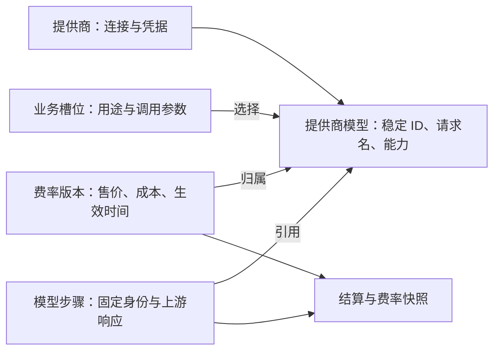

# 提供商模型、槽位与费率关联重构

状态：分阶段实施中。用户已认可「提供商下的模型作为统一身份」方向；P1–P3 已实现并等待评审，P4–P6 尚未开始。本文中的数据结构与迁移步骤是拟实施设计，实施中的差异以代码和 PR 为准。仅编写本计划不执行数据库写入、部署或历史补扣。

## 目标与范围

让 Admin 在模型管理里完成一条连贯流程：配置提供商 → 获取或手动登记该提供商的模型 → 配置费率 → 分配业务槽位。不同提供商即使使用相同模型名，也有独立身份与价格；运行用量和结算引用同一身份，槽位切换、上游响应名称变化都不改变旧运行的归属。

本轮包括：提供商模型持久化、模型能力与槽位参数分离、费率关联、两条模型调用路径的身份传递、管理界面、迁移与验证。

本轮不包括：跨提供商的全局模型目录、故障转移或负载均衡、自动抓取价格、自动推断模型能力、新增协议、扩展收费范围。额度管理的菜单/页签、用户搜索下拉和管理员配额操作由[额度管理计划](archive/admin-credit-quota.md)负责，可独立实施，不作为本重构的前置条件；任务清单统一收在额度管理计划中。

保持现有业务规则：四个槽位及必需/可选关系不变；缺费率仍进入待处理，不新增「没价格就禁止生成」规则；按步骤发生时间取有效费率；已计价步骤和已结算金额不因改配置而重算；池扣减、冲正、透支线与补结算幂等规则不变。

## 现状与问题证据

| 现状 | 代码入口 | 带来的问题 |
| --- | --- | --- |
| 提供商独立存储；槽位直接存提供商、模型名、能力和参数 | [schema.ts](../../src/server/infra/schema.ts)、[model-config.ts](../../src/shared/model-config.ts)、[store.ts](../../src/server/models/store.ts) | 没有可被槽位、费率和用量共同引用的提供商模型记录 |
| 获取上游模型只更新浏览器候选，不落库 | [model-manager.tsx](../../src/components/model-manager.tsx)、[probe.ts](../../src/server/models/probe.ts) | 选择过的模型与费率表单没有联动；能力在多个槽位重复声明 |
| 费率按提供商 ID、模型名、生效时间匹配；追加时不验证模型归属 | [rate-card.ts](../../src/server/billing/rate-card.ts)、[rate-card-panel.tsx](../../src/components/billing/rate-card-panel.tsx) | 同名跨提供商已经可以区分，但两个自由输入框允许配置出运行永远用不到的价 |
| 迁移内预置两条 `env-default` 费率 | [008_credit_rate_card.sql](../../migrations/008_credit_rate_card.sql) | 初始费率不能代表实际接入提供商的价格，也不能自动套到其它模型 |
| 步骤中的模型名优先使用上游响应名；定价尝试多组字符串键 | [durable-engine.ts](../../src/server/generation/durable-engine.ts)、[pricing.ts](../../src/server/billing/pricing.ts) | 配置名与响应名不同时存在匹配失败风险；历史关联不能靠当前槽位反推 |
| Next 注册表和 harness 各自适配同一份配置 | [registry.ts](../../src/server/models/registry.ts)、[model-domain.ts](../../src/server/generation/durable/model-domain.ts) | 两处都必须接入新身份；只改管理表单或单条运行路径不足以完成重构 |

上述为代码核对结果，尚未对当前开发库做历史数据预检；历史记录能自动关联的比例、能力冲突数量未知。

## 数据分层与不变量

### 提供商

继续使用 `model_provider` 管理地址、协议、凭据、自定义请求头、连接级选项与启用状态。提供商表示一个实际接入配置，不等于模型厂商；同一厂商的官方端点和第三方网关是不同提供商。

提供商 ID 不改名、不复用。密钥轮换和连接维护沿用现有机制；更换为另一业务来源时新建提供商。运行描述继续固定当时的地址和协议，不能用当前地址解释过去的调用。

### 提供商模型

新增 `provider_model`，使用雪花 BIGINT 主键，对外为十进制字符串。核心字段：`id`、`providerId`、`upstreamModelName`、`displayName`、`capabilities`、`compatibility`、`enabled`、创建/更新时间。

- `providerId` 外键引用提供商；`(providerId, upstreamModelName)` 唯一，按原字符串区分大小写，不去版本后缀、不跨提供商归并。
- `id`、`providerId`、`upstreamModelName` 创建后不变。改变实际请求名称应登记另一条模型记录，并显式重新分配槽位、配置价格。
- 模型停用保留记录，不物理删除已被槽位、费率或用量引用的身份；同一请求名恢复使用时复用原记录。
- 获取 `/models` 仅发现候选；Admin 选取后才登记。允许手动登记不支持 `/models` 的提供商，获取失败不能清空已登记模型。
- 上游列出模型不等于已验证推理、工具调用或视觉能力。登记时显式确认能力，不能把所有能力自动勾选为真。

### 上游模型列表变化

上游 `/models` 是一次发现结果，本地 `provider_model` 是 Admin 已确认的配置，两者分别管理。刷新上游列表只比较候选变化，不把本地模型表替换成上游当前列表，也不自动变更槽位、费率、能力或启用状态。本轮采用 Admin 手动刷新，不引入定时同步任务；生成热路径不依赖 `/models` 可用。

| 上游变化 | 本轮处理 |
| --- | --- |
| 新增请求模型名 | 显示「未登记」候选，由 Admin 登记、确认能力、配置费率并按需分配槽位；不自动上架、不继承相似名字的价格 |
| 已登记模型本次未返回 | 提示「本次列表未返回」并列出引用槽位；保留本地模型和价格，不自动停用、删除或改指其它模型 |
| 请求模型名改名 | 新名称登记为另一条模型；旧名称保留，Admin 显式配置新价并迁移槽位，不猜测两个名称等价 |
| 同一请求名重新出现 | 识别为已登记记录，不重复创建、不自动重新启用；上游实际语义是否变化需重新确认 |
| 获取失败、无权限、不支持 `/models`、返回格式异常 | 显示获取失败或无法判断，保留本地配置；不能把失败解释为所有模型下架 |
| 空列表、分页未取全、达到响应/数量上限 | 明确结果是否完整；空列表也不触发删除，不完整结果中的缺项只标「未确认」 |

获取结果必须携带获取时间、所用提供商配置版本和完整性说明。当前 [probe.ts](../../src/server/models/probe.ts) 会限制候选数量，实施时不能把截断列表当作完整目录。只在能确认完整时展示本次返回与本地登记的完整差异；不支持的分页方式不猜测，显示结果有限并保留手动登记入口。

观测信息只属于发现界面，本轮不新增持久化的「模型可用/不可用」状态。刷新页面后未重新获取时显示「尚未获取」，不能把旧观察伪装成当前状态；一次获取过程中提供商配置已改变时，丢弃旧版本结果或标为过期，禁止据此对新配置登记候选。重复刷新不能增加模型记录、触发计费或改变配置 revision/refreshEpoch。

「列表里有」「上游实际可调用」「Admin 已启用」是三个不同事实。上游可能隐藏可调用模型、返回过期列表，或按密钥权限过滤；因此本次未返回只提供核查线索。若模型实际调用失败，沿用现有错误与结算规则，不自动切模型、不重放已执行工具。运行绑定固定只保证本地不会换模型，不能保证上游下架后旧请求仍能执行。

若提供商在同一个请求名背后替换实际模型或改变能力、价格，`/models` 可能完全不变，本系统不能仅靠列表识别。保留上游响应名帮助核查；Admin 确认后更新能力/兼容声明并追加带生效时间的费率，影响新绑定或尚未计价步骤，已计价事实和历史快照不变。

### 槽位与设置归属

保留 `model_alias` 作为现有槽位分配存储，不再新增一份槽位定义表。槽位定义继续只有 [modelSlots](../../src/shared/model-config.ts) 一处，新增 `providerModelId` 引用。

| 信息 | 唯一配置归属 | 说明 |
| --- | --- | --- |
| 地址、协议、凭据、headers、现有连接级选项 | 提供商 | 本轮不扩展协议选项体系 |
| streaming、toolCalling、structuredOutput、imageInput | 提供商模型 | 表示该提供商实际暴露的能力，多个槽位共用 |
| `reasoningContentPassthrough` | 提供商模型的兼容声明 | 属于该模型的协议兼容行为，不应每个槽位重复配置 |
| temperature、topP、maxOutputTokens、reasoning | 槽位调用参数 | 同一模型可因业务用途采用不同参数，参数合成规则统一实现 |
| 槽位名称、用途、必需能力、未配置影响 | 代码常量 | 槽位只能选择满足要求且启用的模型 |

编辑模型能力时，事务内检查所有引用它的启用槽位；不能让现有必需槽位失去要求的能力。启用槽位不能引用停用模型或停用提供商；停用前必须先处理引用。可选槽位仍可解除分配。

`version.summary` 和 `speech.transcribe` 也引用提供商模型，但保留原有调用方式与降级行为；语音模型登记不能被新增的「必须支持聊天」校验拦住。版本标题当前会在专用模型不可用时尝试生成模型，再由调用方兜底，不能在迁移中意外删掉这一行为。

### 费率版本

复用 `credit_rate_card`，新增 `providerModelId`；增加 `(provider_model_id, effective_from)` 的唯一约束和按模型、生效时间的查询索引。旧列和旧复合主键保留，原历史行不改写。新版本的 `provider_id`、`model_name` 由所选模型派生存储，不能由客户端另填一套身份。

- 新写入只接收 `providerModelId` 与价格等业务字段；验证模型存在、归属正确，身份字段不可相互矛盾。
- Credit 售价和上游 USD 成本继续分别保存，成本未知仍为 NULL，不从售价反算成本。
- 改价只追加版本，不覆盖历史；未来价不提前生效，无生效价就待处理。
- 管理界面在模型下展示全部费率历史、当前生效版本、未来版本及缺价状态。缺价状态从费率事实派生，不再存一份 `hasPrice`。
- 保留给停用模型补历史费率的能力，以处理旧待结算记录；不因停用而让历史账单失去补价入口。
- 已应用的初始迁移原样保留。新初始化不把其中两条价格复制给任意新模型；与实际模型不能明确对应的旧价只作为历史记录展示。

### 运行身份与账单

新产品模型调用的公开身份增加 `providerModelId`；在 `generation_step` 增加可空 `provider_model_id`。已有名称列继续保留可读信息，新步骤按以下语义写入：

- 模型配置身份：固定的 `providerModelId`、提供商 ID、请求模型名、槽位编号。
- 上游元数据：独立保存实际 `upstreamProvider`、`upstreamModelId`，不覆盖配置身份。
- 费率选择：有稳定 ID 的步骤只按该 ID 和步骤时间查价；不能匹配不到后退回响应名或当前槽位。
- 新账单快照保存模型 ID 与实际费率版本；旧 JSON 快照允许没有新字段，保持可读。

不把费率固定到生成准入时：维持现有按每步发生时间选价的口径，跨费率生效时刻的生成按步骤分别计价。补结算只处理原本未计价或后来新增的步骤，沿用现有 stepId 去重和分池分录逻辑。

## 模块职责与运行接入

`models/` 提供统一的槽位解析 Interface，组装提供商、提供商模型和槽位参数，返回不可变的有效配置及公开身份。调用方不再自行拼接名称、覆盖能力或回查当前槽位。该模块不承担扣款或费率计算。

- 配置存储：在同一一致读事务中加载提供商、模型、槽位与状态行；沿用 `expectedRevision`、配置写锁、`refreshEpoch` 与原有缓存故障语义。模型编辑也参与版本控制，不能通过新表绕过。
- Next Adapter：注册表沿用现有 `resolveModel` / `resolveBinding` 的主要调用方式，从统一有效配置构建 AI SDK 模型。
- harness Adapter：从同一解析逻辑生成 pi-ai 配置；保留准入 token 和运行描述，当前运行、工具调用和修复轮继续使用已固定绑定。
- 语音转写：由同一次解析得到目标模型和连接信息，避免先读缓存绑定、再读另一份提供商快照造成混用；凭据仍只在服务端解析。
- 管理端读模型：组合配置状态与 billing 提供的费率摘要，让 Admin 看见完整关系；运行模型解析不反向依赖 billing。
- billing：读取稳定模型 ID 与费率事实，校验引用；不导入引擎或控制平面。维持 [服务端约束](../../src/server/AGENTS.md) 的依赖方向。

费率追加与模型配置分别使用自己的版本语义；单独改价不要求重建模型注册表。管理端保存价格后刷新价格摘要即可，不能用模型缓存版本判断价格是否生效。

运行描述必须兼容已有 `app.run-model` 数据：支持无新身份的旧描述与带模型 ID 的新描述，不能仅提高文档版本导致旧会话不可读取。重启按保存的描述恢复，不解析当前槽位；旧凭据引用失效时明确失败，不换一家提供商继续执行。

夹具与 `DURABLE_MODEL_*` 显式覆盖仍属于独立来源，不伪造产品模型 ID。旧来源标识继续可读，计费缺价仍保持待处理；本轮不偷偷取消环境覆盖，也不把它的用量套到 `env-default` 的价格。

## 管理界面与请求契约

模型管理沿用现有入口和设计风格，按「提供商 / 提供商模型 / 模型分配」组织，费率作为模型详情的一部分；可以保留总览入口，但不得再维护一套不关联模型的新增表单。

1. 在提供商下获取上游候选，或手动登记请求模型名；登记后编辑展示名、能力与兼容声明。
2. 模型列表展示提供商名称与 ID、请求模型名、启用状态、引用槽位、当前售价/缺价提示。跨提供商同名模型必须同时可辨。
3. 从模型行进入费率详情追加版本；提供商和模型只读，上游成本与 Credit 售价分组展示。生效时间统一转换 UTC，界面明确时区。
4. 分配槽位时按提供商筛选已登记模型；展示能力是否满足、费率是否齐全，不能通过表单强行把模型能力改成符合要求。
5. 对迁移未关联的旧费率单独显示「历史费率，未关联模型」，保留查阅与受控关联入口，不伪装成当前已配置价格。
6. 正确处理加载、空列表、获取上游失败、保存冲突、失效引用与窄屏布局；保留键盘搜索与选择。antd 的 Form.Item 必须直接绑定控件。

HTTP 仍使用现有业务信封、管理员鉴权、来源校验和错误处理。新增模型登记/更新/停用入口；槽位写入从接收两个身份字符串改为 `providerModelId`；费率写入同理。旧写入口在切换后不再接受「任意提供商 + 名称」新增价格或绑定，返回明确的重新加载提示，避免旧页面静默写入旧结构。路由名与 zod 契约在实施时一次更新调用方和测试，不维持长期双写协议。

## 历史数据迁移

采用新增表/列、预检、幂等回填、统一切换的路径。不得重写任何已应用 SQL；Drizzle schema 同步追加定义，保留旧字段和历史 JSON。后续若要删除旧列，作为另一次迁移，不混在本轮切换里。

### 预检与关联规则

新增一次性迁移工具，默认 dry-run，显式 `--apply` 才写入；按 [脚本规则](../../scripts/AGENTS.md) 校验目标库。输出不含密钥、密文或请求头值，只含身份、计数、冲突与关联依据。

| 数据来源 | 可自动处理的条件 | 无法确定时 |
| --- | --- | --- |
| 当前槽位的提供商 + 请求模型名 | 提供商存在；同组槽位能力和模型兼容声明一致 | 输出冲突，不能取能力并集或任挑一条 |
| 多个槽位共用一个模型 | 合并模型身份，分别保留各槽位的采样、输出预算和思考参数 | 只对模型级字段冲突要求显式裁决 |
| 现有费率 | 与已确认的提供商模型请求名精确对应 | 保留未关联，不制造提供商、能力或连接配置 |
| 旧步骤 | 有持久运行描述、账单快照等可核对证据，能确定配置身份 | 保持模型 ID 为空并列入报告，不用当前槽位推断 |
| 已结算/已冲正账单 | 继续读原快照和分录 | 不重算、不改金额、不改历史快照 |

纯名称相等不足以证明旧步骤身份；去 `#` 后缀或把响应版本名当请求名也不是自动回填依据。人工关联需要保存明确的旧键、目标模型 ID、依据和操作人，不使用模糊匹配规则批量套价。迁移工具不得顺带调用补结算。

### 执行顺序

1. **只读预检**：记录迁移前配置版本、必需槽位、模型归并组、冲突、孤立费率和未定价量。分别列出可自动处理、需确认、保持历史未关联的数据。
2. **追加结构**：新表、可空引用列、索引和约束；旧程序仍可运行。对旧数据允许 NULL，新程序通过写入口保证产品模型新写入有 ID。
3. **确认冲突**：对现有必需槽位相关的能力/兼容冲突给出显式选择；未用历史数据可保持未关联，不能因此让整页或所有配置保存失败。
4. **受控回填**：切换窗口内暂停配置写入与新生成提交，等待活动生成结束；事务锁状态行、校验预检版本，幂等创建模型并关联槽位/确定的费率。重复执行不重复建模型；预检后配置变更则中止重做预检。
5. **部署切换**：Next、harness 同版本发布，运行解析与新写入以模型 ID 为准。旧槽位的 provider/name/capabilities 等列仅保存由新模型派生的兼容投影，不再作为独立可编辑真值；原参数里的模型兼容字段迁到模型后不再参与新解析。
6. **核验再开放**：确认必需槽位都有有效目标、模型 ID 与费率关联正确、未产生新 entry、账单金额/快照未变，再恢复提交。全新安装也必须执行新初始化，不仅保证旧库可升级。

历史无 ID 的用量保留独立兼容分支，现有候选键解析只在该分支适用；不能为新 ID 用量启用字符串回退。历史补价和任何可能发生扣费的补结算必须单独审查范围后执行，不能把结构迁移当成补扣授权。

### 回退与失败处理

DDL 和回填前备份，并记录库版本及迁移批次。回填事务失败整批回滚，保留 dry-run 报告供重试；不删除历史账本。

切换前可继续运行旧代码；切换后已有新身份、新费率或新账单写入时，不承诺直接回退旧 billing 代码仍正确。此时暂停新提交，优先修复前进；若需恢复备份，必须先核对新增业务事实，不能用覆盖数据库的方式丢掉已经发生的扣款或发放。部署与共享数据操作另按审批边界执行。

## 实施进度

- P1 契约与存储：已实现（`provider_model`、三个可空引用列、存储读写与测试），见 [PR #122](https://github.com/ZDAN-OvO/paimeng-ai-code-mother/pull/122)。
- P2 历史回填：回填工具见 [PR #126](https://github.com/ZDAN-OvO/paimeng-ai-code-mother/pull/126)；初始化创建提供商模型与槽位引用持久化见 [PR #128](https://github.com/ZDAN-OvO/paimeng-ai-code-mother/pull/128)。
- P3 模型解析与运行身份：统一槽位解析、两条 Adapter、语音同源解析、步骤与运行描述写入模型 ID 见 [PR #129](https://github.com/ZDAN-OvO/paimeng-ai-code-mother/pull/129)。
- P4–P6：未开始。

## 实施阶段与依赖

各阶段包含相应测试，不能等界面完成后再补模型身份验证。阶段依赖为 P1 → P2 → P3 → P4 → P5 → P6；P6 的迁移演练可在 P2 后持续补充，正式切换最后执行。

| 阶段 | 主要工作与落点 | 本阶段验收 |
| --- | --- | --- |
| P1 契约与存储 | 新增模型实体；扩展 shared 契约、schema 和新增迁移；槽位、费率、步骤增加引用 | 同名跨提供商可并存，同提供商重复名拒绝；旧库增量迁移及空库从零迁移成功；旧快照可读 |
| P2 预检与回填 | 一次性工具、冲突报告、模型归并、费率关联与初始化改造 | dry-run 零写入；重复 apply 幂等；冲突不吞；孤立费率不被误接；已结算账单和 entry 不变 |
| P3 模型解析与运行身份 | models 的统一解析、两个 Adapter、语音目标、harness 准入/持久描述/恢复、步骤写入 | 多槽位共用能力而参数不同；配置切换只影响新绑定；响应名不覆盖身份；旧运行可恢复；无凭据泄漏 |
| P4 按身份定价 | rate-card、pricing、settlement、运行期透支评估、快照与历史兼容分支 | 同名不同价不串账；未来价、跨生效时刻、晚到用量和补价正确；重试不多扣，已退还不再补扣 |
| P5 管理流程联动 | 提供商模型列表/详情、上游候选差异与完整性、模型内费率、槽位选择、配置与价格状态汇总 | 不手输两套身份；新增/缺项/重新出现可辨，失败或截断不清数据；重复刷新无配置写入；费率与槽位状态可复查；权限、窄屏和键盘路径通过 |
| P6 验证与切换 | 完整回归、迁移演练、真实功能证据、部署说明和清理 | 下列验收全部有证据；必需槽位可用；迁移无新增扣款；一次性工具完成使命后删除 |

P3、P4 完成前不切生产写路径。拆 PR 时每个 PR 都应能编译和运行现有功能，过渡代码须标明移除阶段；最后一个阶段移除运行时旧字符串配置写法，历史数据读取兼容保留为明确路径。若使用堆叠 PR，最终必须核对完整变更已到 main，不能把合入上层特征分支当作交付完成。

## 验证与证据

### 行为验收矩阵

| 场景 | 必须观察到的结果 | 主要测试层 |
| --- | --- | --- |
| A、B 提供商均有 `same-model`，价格不同 | 请求打到所选提供商；按对应模型 ID 定价，另一方价格不影响它 | integration + 功能旅程 |
| 上游列表新增、缺项、重新出现或改名 | 只更新候选提示；登记需显式操作；原模型 ID、启用状态、槽位、价格和历史账单不变 | integration + e2e |
| 上游列表获取失败、为空、分页/截断，或获取中修改提供商 | 不误报下架、不清本地记录；显示完整性与版本，新配置不使用旧获取结果 | probe integration + e2e |
| 模型仍可调用但本次列表未返回；或列表有模型但调用失败 | 前者仍可按本地启用配置准入，后者沿用调用失败流程；不自动切换或重放工具 | harness integration |
| 请求名与响应名不同 | 身份仍是选定模型，响应名单独保存，正常结算 | 真 harness integration |
| 两槽位共用同一模型 | 模型能力共享，temperature/reasoning 等按槽位独立 | unit + integration |
| 准入后切槽位、改能力或连接参数 | 已准入绑定、运行中工具循环与修复不变；下一次准入使用新配置 | harness integration |
| 保存后立即生效、多进程缓存、并发编辑 | 继续满足 epoch/TTL 和 409 版本冲突语义，不混读不同版本配置 | 现有多进程 integration |
| 新旧持久描述重启恢复 | 旧描述可读，新描述保留模型 ID，均不跟随当前槽位改指 | harness integration |
| 未来价格与运行跨生效时刻 | 未来价不提前应用，按各步骤时间选版本，已计价步骤不重算 | unit + billing integration |
| 缺费率 → 补历史价 → 重试两次 | 第一次只补未计价步骤，第二次无新增扣款，分池金额和账单快照可核对 | billing integration + 功能旅程 |
| 停用或无效引用、普通用户修改配置 | 不破坏现有必需槽位；非法引用、越权和旧写载荷明确拒绝 | integration + e2e |
| 迁移能力冲突、孤立价、旧响应名 | 报告列明，不能静默合并；未关联历史仍可查看 | 迁移 integration |
| 从零安装和重复回填 | 初始化可用，重复执行无重复数据，未自动收费 | integration |
| 版本标题、类型路由、语音转写与图片输入 | 调用与原降级行为保持，模型能力门禁没有被移丢；收费范围未扩大 | 现有相关回归 |

单测仅验证纯归并、引用校验、设置合成和定价选择，不连接数据库、开浏览器或启动子进程。需要真库、多进程、HTTP 上游或 harness 的验证放在 integration，沿用 [测试分层](../../tests/AGENTS.md)。

实施时扩展现有 [models 单测](../../tests/unit/models/)、[models 集成](../../tests/integration/models/)、[harness 模型测试](../../tests/integration/harness/model-config.test.ts)、[billing 测试](../../tests/integration/billing/)、[模型管理 E2E](../../tests/e2e/model-manage.spec.ts) 和 [费率 E2E](../../tests/e2e/billing-rate-card.spec.ts)，不把旧的单接口桩图称为全链路证明。

### 运行门禁

从产品目录运行 `npm run type-check`、`npm test`、聚焦 models/billing/harness 的 integration，再跑完整 integration 和 `npm run check:fast`。共享 `_test` 数据的集成测试按仓库约定串行执行，不与其它重置套件并行。E2E 通过仓库隔离启动器运行；开发模式另核对 antd v6 警告，生产构建通过不能替代这一项。

本工作区已有未提交的根目录文档改动，`verify:boundary` 可能因此失败；实施时记录基线并如实报告，不能修改检查脚本或丢弃用户改动来获取通过。

### 逐步功能证据

使用本机 `verify-paimeng-agent` 技能和仓库隔离启动器，保存「结论 → 断言 → 原始产物」可核对的证据包。最低交付旅程：

1. 初始展示两个提供商，登记相同请求模型名，确认是两条模型记录。
2. 给两条记录配置不同价格，展示保存回执、历史版本与刷新结果。
3. 为代码生成槽位选择 A；运行生成，记录请求目标、固定模型身份、与配置名不同的上游响应名、用量和最终账单。
4. 切换到 B，再次生成；对照两次账单与 fee snapshot，旧账保持 A 的价格。
5. 演示缺价待处理 → 补价 → 单次补记 → 再次重试无新增分录。
6. 改变受控上游的模型列表，依次展示新增、原模型缺项、获取失败及截断；刷新后本地记录、引用槽位和历史账单保持，新增模型需显式登记。
7. 记录模型选择、配置冲突和错误提示；宽屏与 480 宽均可操作。

模型上游可使用明确标注的受控 HTTP 服务，以验证同名、异名响应、时间控制等场景；业务配置、身份传递、结算与 Postgres 必须真实执行。证据注明代码版本、模型边界与故障注入，不用 `page.route` 替代所声称的真实业务。迁移比对与步骤身份 SQL 标注为「非产品界面」；不得把测试总数或文件存在性代替功能操作证据。

## 完成与文档收尾

- [ ] 提供商模型成为新配置与新用量的统一身份；新步骤不再通过字符串候选查价。
- [ ] 两条运行 Adapter、四槽位和已有环境/夹具来源均有明确行为与回归证据。
- [ ] 模型管理完成登记、定价、分配、运行查账的连续流程。
- [ ] 旧库升级、空库初始化、旧描述恢复、迁移重复执行和冲突处理通过演练。
- [ ] 历史已结算账单/快照/分录未改；未关联数据有报告与处理入口，不自动补扣。
- [ ] 更新 [provider-convergence.md](../provider-convergence.md)、[billing-operations.md](../billing-operations.md) 和必要的跨模块契约；模型身份及历史计费兼容的高成本决策形成 ADR，并补齐必要词汇。
- [ ] 删除已完成使命的一次性回填工具及入口；同步[额度管理计划中的关联任务](archive/admin-credit-quota.md)状态，详细设计只维护在本计划中。
- [ ] 用户可见行为有逐步证据，所有未通过/跳过项明确报告；只有完整变更合入目标分支才标记交付。
- [ ] 按 [计划生命周期](../AGENTS.md) 将完成计划归档，并更新归档索引与相关引用。
